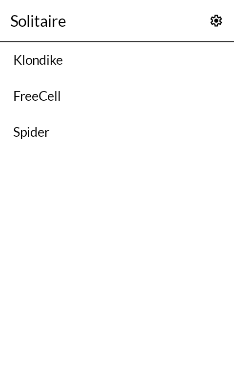
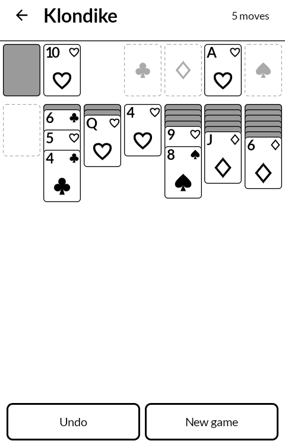
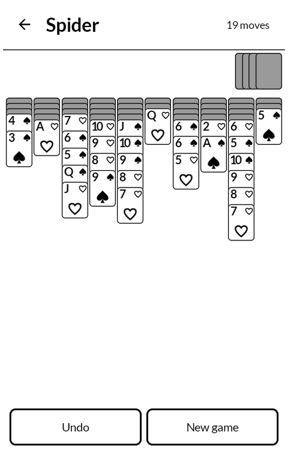
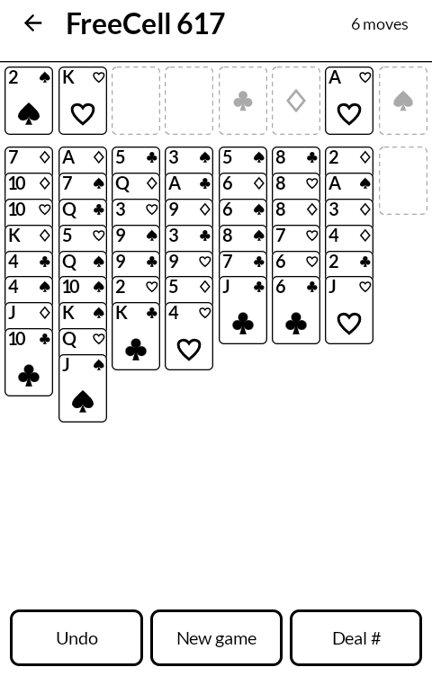

# Solitaire

Klondike, FreeCell and Spider for the [Mudita Kompakt](https://mudita.com/products/kompakt/),
played by tapping, with nothing that moves on its own. It will install on any
device with Android 11 or later, Supernote's tablets among them.

| | |
|---|---|
|  |  |
|  |  |

## Playing

- **Tap a card to move it.** It goes to the best place it can: its foundation when that is
  safe, otherwise the first column from the left that takes it, then an empty column, then
  (in FreeCell) a free cell. Tap it again where it landed and it goes to the next place it
  could, and after the last one back where it started. A card with nowhere to go stays put.
- **Tap a card in a column to move it and everything below it**, where the rules allow that
  run to move together.
- **Tap the stock to deal.** In Klondike, tapping the empty stock turns the waste over.
- **Undo** goes back one move at a time, all the way to the deal.
- **Finish** appears once every card is face up and the stock is used up, and only when the
  game can really be played out from there. One tap puts every card home.
- **New game** asks for a second tap while a game is under way, and forgets itself after four
  seconds. A won game offers **Same deal** too.
- The game in progress is written down after every move. Close the app, or restart the phone,
  and it is where you left it. Each of the three games keeps its own.

## The games

- **Klondike.** Seven columns, one card or three turned from the stock at a time (a setting),
  and as many passes through the stock as you like. Kings, and only kings, go to an empty
  column. A card can come back down from its foundation.
- **FreeCell.** Deals are Microsoft's, numbered 1 to 32000 and dealt from the same numbers,
  so a deal number from anywhere else gives the same game here. **Deal #** plays one by
  number, and the title shows the one on the table. A run moves at once when there is room
  to move it card by card: (free cells + 1) × 2 for each empty column, half that into an
  empty column.
- **Spider.** Ten columns from two decks, in one, two or four suits (a setting). A run of one
  suit moves together; a king-to-ace run of one suit comes off the table by itself. Every
  column needs a card before the next deal from the stock.

A setting changes the next new game, never the one under way. Settings also counts the games
of each kind played and won. There is no timer and no score, only a count of moves.

## On this screen

Cards are white with a black edge. Hearts and diamonds are drawn in outline and spades and
clubs filled, so the two colours read apart in greys. A fanned column shows only each card's
rank and suit; a long column closes up its face-down cards first and then its face-up ones,
so it never runs off the bottom of the screen and nothing scrolls. There is no hint button.

## Building

```
./gradlew assembleDebug
```

A release build needs a keystore at `signing/signing.keystore` with a matching
`signing/signing.properties`. There is no fallback key in this repository: without one, a
release build comes out unsigned rather than wrongly signed.

`./gradlew testDebugUnitTest` runs the rules' tests: the FreeCell deals against Microsoft's
published deals 1 and 617, the run limits, undo, saving, finishing, and a game of each kind
played to a win by taps alone.

## Getting it, and keeping it

Download <https://github.com/wanderwildwood/solitaire/releases/latest/download/solitaire.apk>
and sideload it. That address always points at the newest release, and every release
publishes a `.sha256` beside the APK if you would rather check than trust.

For updates without doing this by hand, add this repository to
[Obtainium](https://github.com/ImranR98/Obtainium):

    https://github.com/wanderwildwood/solitaire

## Licence

GPL-3.0-only. See [LICENSE](LICENSE).

Copyright (C) 2026 wander wildwood

This program is free software: you can redistribute it and/or modify it under the terms of the
GNU General Public License as published by the Free Software Foundation, version 3.

This program is distributed in the hope that it will be useful, but WITHOUT ANY WARRANTY;
without even the implied warranty of MERCHANTABILITY or FITNESS FOR A PARTICULAR PURPOSE. See
the GNU General Public License for more details.

You should have received a copy of the GNU General Public License along with this program. If
not, see <https://www.gnu.org/licenses/>.

Icons are from Material Symbols, Apache 2.0.
